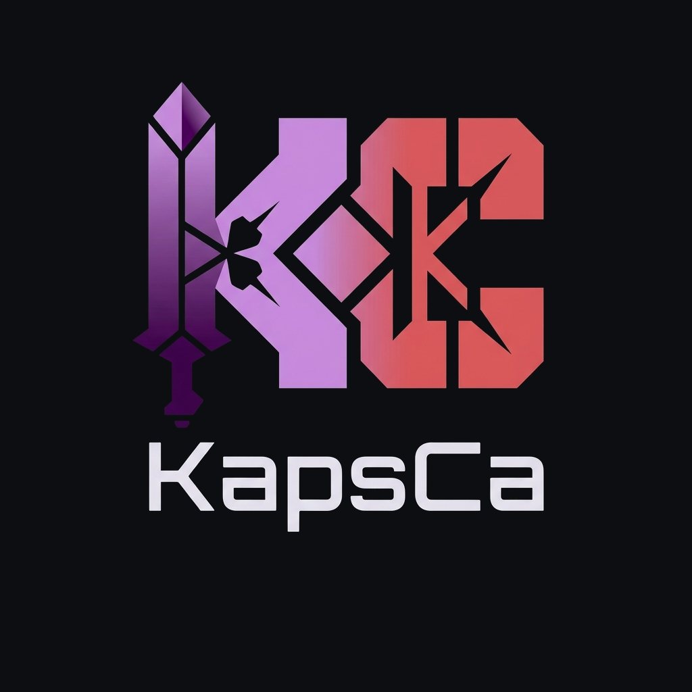

<div align="center">

<picture>
  <source media="(prefers-color-scheme: dark)" srcset="dist/kapsca-logo-principal-dark.png">
  <source media="(prefers-color-scheme: light)" srcset="dist/kapsca-logo-monocromo-negro.svg">
  
</picture>

**KapsCa brand kit** · paleta medida en `docs/tokens.json` · distribuido en `dist/`

</div>

---

Kit de marca personal de **KapsCa**: logos, íconos, favicons, banners y tokens de paleta con contraste medido (WCAG).

## Contenido de `dist/`

| Grupo | Archivos | Uso |
|---|---|---|
| Logos principal | `kapsca-logo-principal-transparente.png`, `kapsca-logo-principal-dark.png` | READMEs, cara de la marca (1024², wordmark incluido) |
| Isotipo + monocromos | `kapsca-isotipo-(transparente/dark-avatar/monocromo-*).png` | avatares, íconos, tintas única |
| Favicons | `favicon.ico` (16→256) + `favicon-*.png` | navegador, apps, GitHub user pic |
| Banners | `kapsca-repo-banner-1280x640.png`, `kapsca-profile-banner-1500x500.png` | encabezados de repo y perfil |
| Vectores (Gemini-trace) | `kapsca-isotipo.svg`, `kapsca-logo-{principal,dark,monocromo-*}.svg` | escalado infinito; degradados aproximados (QA: fiel en geometría) |
| Integridad | `manifest.sha256` | `sha256sum -c` en CI |

## Consumo en otro repo (vendored)

Cada repo KapsCa lleva un set liviano copiado en `assets/brand/` (banner, `kapsca-512.png`, monocromo SVG, favicon ICO ~370 KB). El repo es autosustentable; este repo es la fuente única (SOT) y el instalador de repo-bootstrap copia desde aquí en repos nuevos.

## Snippet de header README (picture dark/light)

```html
<p align="center"><picture>
  <source media="(prefers-color-scheme: dark)" srcset="assets/brand/kapsca-512.png">
  <source media="(prefers-color-scheme: light)" srcset="assets/brand/kapsca-mono-white.svg">
  
</picture></p>

<p align="center"></p>
```

## Paleta (medida)

Tokens dark y light completos en `docs/tokens.json`; los contrastes y roles están medidos (WCAG + ΔE).

- Canvas `#0D0E12` · Ink `#ECE9F2` · Accent `#E5384F` · Brand `#CE97EB`.
- **Prohibición 1**: `#CE97EB` sobre blanco = 2.26:1 → en modo claro usar `#7A2E9E`.
- **Prohibición 2**: `#E5384F` sobre `#CE97EB` = 1.85:1 → el rojo nunca entra sobre violeta claro.

## Flujo de release

`release-please` (config `simple`) controla versiones con Conventional Commits; en cada release, `release-assets` sube `kapsca-brand-dist.zip`. Para descargar el kit fijado: `https://github.com/KapsCa/kapsca-brand/releases` → `Assets` → zip.

## Licencia

Brand assets: propiedad de KapsCa. Condiciones en [`LICENSE`](LICENSE).
