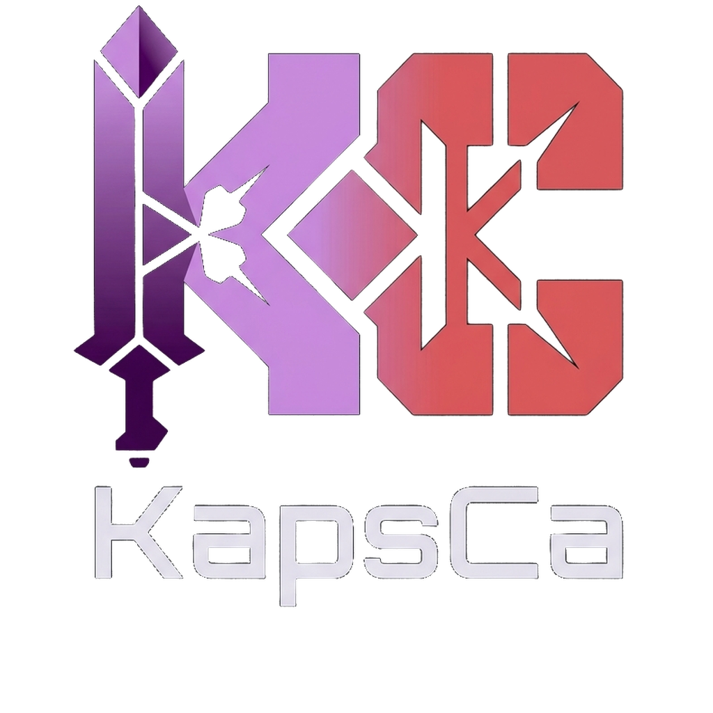
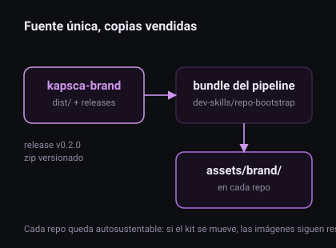

<a id="top"></a>

<div align="center">

<picture>
  <source media="(prefers-color-scheme: dark)" srcset="dist/kapsca-logo-principal-transparente.png">
  <source media="(prefers-color-scheme: light)" srcset="dist/kapsca-logo-monocromo-negro.svg">
  
</picture>

<h1>KapsCa Brand Kit</h1>

<p><strong>La fuente unica de la marca: logos, banners, favicons y una paleta con contraste medido.</strong></p>

<p>


</p>

<p>
<a href="#contenido"><strong>Contenido</strong></a> &bull;
<a href="#paleta"><strong>Paleta</strong></a> &bull;
<a href="#consumo"><strong>Consumo</strong></a> &bull;
<a href="#release"><strong>Release</strong></a>
</p>

</div>

---

<p>
Todo repositorio de KapsCa presenta la misma marca porque la toma de aca. El kit publica assets raster y
vectoriales en <code>dist/</code>, con un manifiesto SHA-256 verificado en CI en cada push, y una release
versionada cada vez que cambia. Los repositorios consumidores reciben una copia liviana: no dependen de
este repositorio para renderizar.
</p>



## Contenido

| Grupo | Archivos | Uso |
|---|---|---|
| Logotipo | `kapsca-logo-principal-transparente.png`, `kapsca-logo-principal-dark.png` | cara de la marca, con wordmark incluido (1024 px) |
| Isotipo | `kapsca-isotipo-transparente.png`, `kapsca-isotipo-dark-avatar.png` | avatares, iconos de app |
| Monocromos | `kapsca-logo-monocromo-blanco.png`, `-negro.png` y equivalentes del isotipo, en PNG y SVG | una sola tinta, fondos claros u oscuros |
| Favicons | `favicon.ico` (16 a 256) y `favicon-16/32/64/180/192/512.png` | navegador, manifest, user pic |
| Banners | `kapsca-github-repo-banner-1280x640.png`, `kapsca-profile-banner-1500x500.png` | encabezados de repositorio y de perfil |
| Vectores | `kapsca-isotipo.svg`, `kapsca-logo-*.svg` | escala sin perdida; degradados aproximados |
| Integridad | `manifest.sha256` | verificacion automatica en CI |

> Sobre los vectores: son un trazado fiel en geometria, con degradados reconstruidos. Para reproducir el
> degradado original exacto, usar los PNG.

## Paleta

Los tokens completos estan en `docs/tokens.json`. Los contrastes estan medidos (WCAG y delta E), no elegidos
a ojo.

| Token | Dark | Light | Rol |
|---|---|---|---|
| `canvas` | `#0D0E12` | `#FBFAFD` | fondo de pagina |
| `surface` | `#180F1F` | `#FFFFFF` | panel y tarjeta |
| `brand` | `#CE97EB` | `#7A2E9E` | violeta de marca: texto, iconos, enlaces |
| `brand-strong` | `#B26FE0` | `#63238A` | hover y estado activo |
| `accent` | `#E5384F` | `#C42B40` | tension: error, alerta, destructivo |
| `ink` | `#ECE9F2` | `#1B1420` | texto principal |

Dos reglas que surgieron de medir:

1. `#CE97EB` sobre blanco da 2.26:1. En modo claro el violeta de marca no sirve como texto: se usa `#7A2E9E`.
2. `#E5384F` sobre `#CE97EB` da 1.85:1. El rojo nunca se apoya sobre el violeta claro.

Regla de composicion: el PNG `-dark` tiene el fondo `#0D0E12` horneado y solo va en contextos de ese color
(avatares, social preview, fondos propios). En un README de GitHub se usa el transparente, o el monocromo
para modo claro.

## Consumo

Cada repositorio lleva un set liviano copiado en `assets/brand/`:

```
assets/brand/
├── banner.png              banner de repositorio (1280x640)
├── kapsca-512.png          isotipo transparente
├── kapsca-mono-white.svg   monocromo vectorial
└── kapsca-favicon.ico      favicon multi-tamano
```

El header de presentacion se inserta con el marcador `kapsca-brand`, de modo que actualizarlo sea
idempotente:

```html
<p align="center"></p>
```

Los repositorios nuevos lo reciben automaticamente desde `repo-bootstrap`
([kkapsca-skills](https://github.com/KapsCa/kkapsca-skills)), que copia el bundle del pipeline.

## Release

`release-please` calcula la version desde Conventional Commits. En cada release, el workflow `release-assets`
publica `kapsca-brand-dist.zip` con todo `dist/` adentro.

```bash
gh release download --repo KapsCa/kapsca-brand --pattern 'kapsca-brand-dist.zip'
```

`dist-integrity` verifica `manifest.sha256` en cada push y en cada pull request: si un asset cambia sin
actualizar el manifiesto, el check falla.

## Licencia

Marca y assets son propiedad de KapsCa. Las condiciones de uso estan en [LICENSE](LICENSE).
